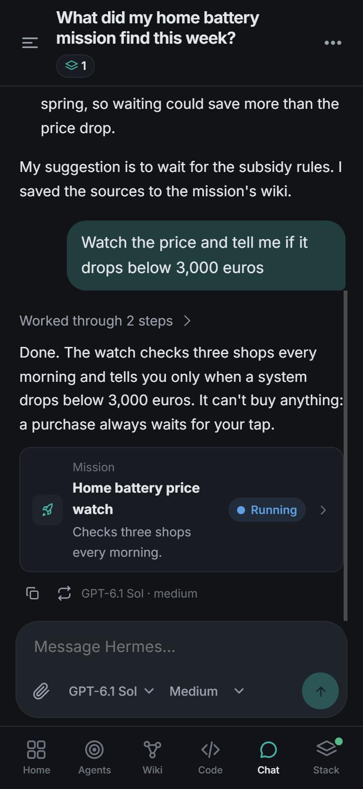
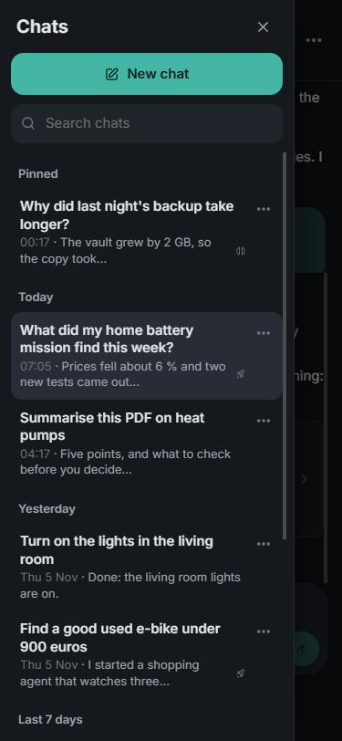
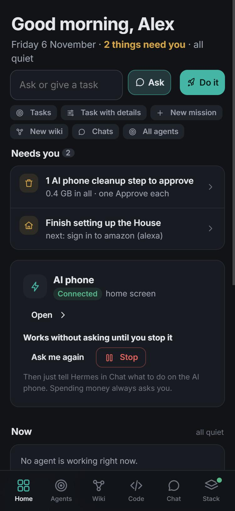
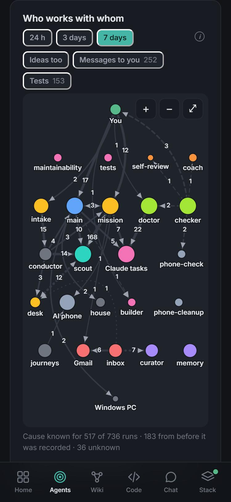
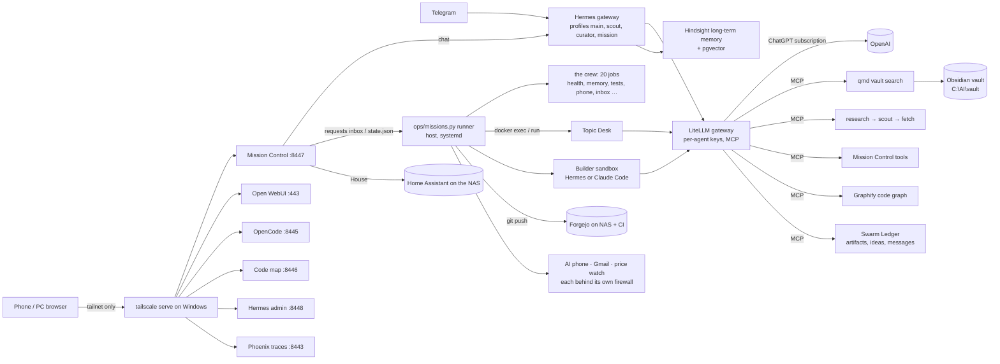

# ai-stack

**Your own team of AI agents, running at home on one PC and used from your phone.**

It chats with you, researches topics for weeks, writes briefings, watches shops and news for you, looks after its own
health, and improves its own code in a sandbox. It can use a spare Android phone and your Gmail. Anything that matters
waits for your tap. Every model runs on a flat-rate subscription (ChatGPT, and Claude for Claude Code), with no paid
model configured, so it can't run up a bill.

<table>
  <tr>
    <td width="25%"></td>
    <td width="25%"></td>
    <td width="25%"></td>
    <td width="25%"></td>
  </tr>
  <tr>
    <td><b>Chat</b>: it acts, and shows what it made</td>
    <td><b>Your chats</b>: swipe right for the list</td>
    <td><b>Home</b>: what needs you, and one box for anything else</td>
    <td><b>The agents</b>: who works with whom</td>
  </tr>
</table>

<sub>The chats and Home show demo data. The map shows a real week of runs, which holds only agent names and counts.</sub>

## What it does

- **Chat with an assistant that can act.** Attach pictures and documents. It knows your notes, starts missions, researches the web and e-mails you the result.
- **Missions.** Daily briefings, research that runs for weeks and builds its own linked wiki, alerts on filings, prices and news, and shopping watches. A purchase always waits for your tap.
- **A crew that runs the place.** 20 scheduled jobs check health, tidy memory, sort your inbox, run the tests and suggest improvements. You hear only what needs you.
- **Code.** Study any repository as a graph and a code map. A builder changes code in a sandbox, and nothing deploys without your approval.
- **Hands in the real world, on a short leash.** An old phone, Gmail and Home Assistant, each behind its own firewall. The AI phone can never approve itself.
- **Your Windows PC, read-only.** The stack can ask Claude Code on Windows about your files, only in folders you list there. WSL still can't start anything on Windows.
- **Everything visible.** One record of every agent run, a map of who works with whom, and costs and resources per agent.

You use it from your phone through **Mission Control**, an installable web app on your private tailnet, and through
Telegram. Your Tailscale login is the only sign-in. A built-in guide (Stack → Guide) explains every screen with examples
you can try.

## How it's built

It runs on one Windows 10 PC (WSL2, rootless Docker), with a Synology NAS for git, CI, Home Assistant and backups.

Most of the work here went into keeping agents honest and safe:

- Every behaviour is a [requirement](requirements/README.md) claimed by a test, and each change must pass the full check before it lands.
- Each agent has its own key and tool grants, web content stays in an isolated scout, and no secrets reach git except encrypted ones.
- Nothing you read is cut off without saying so, and agent prompts are versioned and replay-tested.
- Backups are encrypted every night and proven by a weekly restore drill, and moving to a new PC is rehearsed.

This is one person's real setup, published as a reference, not an installer you can run in a minute. To build your own,
start with [NEW-MACHINE.md](NEW-MACHINE.md). This public copy holds no personal data: see [docs/PUBLISHING.md](docs/PUBLISHING.md).

## Documents

| | |
|---|---|
| **What the stack shall do** (the source of truth for behaviour) | [requirements/](requirements/README.md), rendered in [REQUIREMENTS.md](requirements/REQUIREMENTS.md) |
| Where the swarm goes next | [docs/SWARM-ROADMAP.md](docs/SWARM-ROADMAP.md), its requirements in [requirements/tasks.yaml](requirements/tasks.yaml) |
| Status, findings and what is next | [the review of 30 October 2026](docs/REVIEW-2026-10-30.md), and the open findings in [requirements/findings.yaml](requirements/findings.yaml) |
| Every other document, current and historical | [docs/README.md](docs/README.md) |
| Mission Control: how the app and the runner talk | [docs/MISSION-CONTROL.md](docs/MISSION-CONTROL.md), its HTTP API in [docs/API.md](docs/API.md) |
| Security model and accepted risks | [docs/SECURITY.md](docs/SECURITY.md) |
| The public copy on GitHub, without personal data | [docs/PUBLISHING.md](docs/PUBLISHING.md); MIT licensed ([LICENSE](LICENSE)) |
| Rules for coding agents working on this repo | [AGENTS.md](AGENTS.md), and an `AGENTS.md` in every directory |
| Upgrades (monthly window) and a move to a new PC (rehearsed) | [UPGRADE.md](UPGRADE.md), [NEW-MACHINE.md](NEW-MACHINE.md) |

## Architecture



**Hosts.** Windows 10 Pro (i7-7700K, 16 GB RAM) runs WSL2 `Ubuntu-24.04` (10 GB cap) with rootless Docker,
compose project `aistack`. The NAS (Synology DS923+, 192.168.1.80) runs Forgejo (git + CI) and Home Assistant,
and stores the encrypted nightly backups. Windows tasks keep WSL alive, heal the WSL disk, copy backups to OneDrive,
sync Bitbucket and probe resources.

## Components

| Service | What it does | Network reach |
|---|---|---|
| `litellm` | Model gateway: per-agent virtual keys (`ops/keys.sh`), subscription models `gpt-sub` / `gpt-sub-fast`, MCP gateway with per-key tool grants, Phoenix traces | internet (OpenAI), internal |
| `hermes` | The assistant (Hermes Agent 0.22.5): main profile (chat, Telegram, API), `scout` (web research), `curator` (vault wiki), `mission` (mission runs) | LiteLLM, Telegram, memory |
| `hermes-dashboard` | Hermes' own admin UI (skills, cron, logs, sessions) | internal |
| `mission-control` | The app (Starlette + vanilla JS PWA), its MCP tools and the run record ([API](docs/API.md)) | Hermes, LiteLLM, push services |
| `builder` | Sandboxed coding agent (Hermes or Claude Code, with shell and files) for build assignments | LiteLLM, npm/PyPI proxy only |
| `qmd` | Hybrid search (BM25 + vectors) over vault, topics, specs, code digests, mail/chats | none |
| `hindsight` + `hindsight-db` | Long-term memory from every conversation (local multilingual models) | memory network only |
| `research`, `fetch` | Web research tool: privacy guard → scout agent → isolated page reader (PDF capable, LAN blocked) | internet (fetch only) |
| `graphify`, `opencode`, `ua-viewer` | Code graph MCP, coding UI, Understand Anything code map | internal / package proxy |
| `gate-hermes-dashboard` (+ the code map's gate sidecar) | Single sign-in: admits only requests carrying your Tailscale login (`config/gate`) | shares the app's network namespace |
| `swarm` | The agent swarm's Ledger: every agent-produced artifact, idea and message with its history and lifecycle | no port, no internet |
| `phone`, `mail`, `browser`, `pricewatch` | The AI phone (ADB to the old S22), the Gmail connector, the scout's shop browser, the shopping price watch; each sealed by its own firewall | one target each |
| `openwebui`, `phoenix`, `postgres`, `ollama`, `pkgproxy`, `ci-runner` | Classic chat UI, traces, LiteLLM DB, smoke-test model, npm/PyPI proxy, Forgejo runner | as needed |

Host side (`ops/`, systemd user units in `ops/systemd/`): `missions.py` (the runner: missions, events, builds,
resources, the inbox), `crew.py` (the crew's 20 jobs and the health board), `builds.py` / `deploy.py` (builds and
deploys after your tap), `land.sh` (how a supervised session lands its work), `shopping.py`, `librarian.py`,
`desk.sh`, `backup.sh` / `restore.sh` (nightly backup, weekly drill), `vault-ingest.sh`, `graphify-sync.sh`,
`digest.py`, `upgrade_check.py`. Windows tasks are in `ops/windows/`.

## Repository layout

```
compose/        core.yaml (LiteLLM, Postgres, Phoenix, Ollama), apps.yaml (everything else), rehearsal.yaml
config/         litellm/config.yaml, hermes/configure*.sh (one script per Hermes profile), agents.yaml (the agent registry)
images/         one directory per custom image (Dockerfile + code); mission-control/ is the app and its guide
ops/            host side: runner, crew, builds and deploys, desk, backups, keys, checks, systemd units, Windows scripts
prompts/        every agent prompt as a versioned, replay-tested file (MEM-11)
requirements/   the requirements, decisions and findings (YAML), checked by ops/req.py and rendered to REQUIREMENTS.md
tests/          the unit tests (all fakes, no services); every test is claimed by a requirement
secrets/        sops + age encrypted: secrets.enc.yaml (providers, tokens), agent-keys.enc.yaml (virtual keys)
spec/           the requirements checker (ingest, extract, link, judge)
eval/           frozen benchmark (bench-v1.yaml, FROZEN.sha256) and retrieval eval
nas/            what runs on the NAS (Forgejo, Home Assistant)
smoke/          wiring test (no tokens spent)
vault-template/ AGENTS.md contract of the Obsidian vault
```

## Operating it

Everything runs by itself (timers, the runner, the crew, Windows tasks). Day to day you use Mission Control.
From a terminal (`grep '##' Makefile` lists every target; secrets are decrypted per command, never printed):

| Command | |
|---|---|
| `make up` / `make down` / `make ps` / `make logs` | start, stop, status, logs |
| `make check` | every check CI and each landing run (below) |
| `make smoke` | wiring test, no tokens spent |
| `make keys` / `python3 ops/update-keys.py` | create / update per-agent keys from `ops/keys.sh` |
| `make backup` / `make restore-drill` / `make restore` | encrypted backup to the NAS, prove it restores, restore |
| `make lock` | record which image every container runs into `versions.lock` |
| `make desk TOPIC=uranium` | run a briefing now |
| `make wiki-rebuild MISSION=slug` | compile a mission's wiki from all its results |
| `make email-setup` | one-time Gmail app password for report e-mails |
| `make understand REPO=<url>` | code graph + code map of a repository |
| `make bench-gate` / `make bench` | frozen quality benchmark (subscription only) |
| `make upgrade-check` | newer releases of pinned components (changes nothing) |

**Checks** (`ops/check.sh`, the same in CI, in the builder and in every landing): shellcheck, ruff, the app's
scripts (syntax and undefined names), YAML, Semgrep with the repo's own rules, the frozen benchmark, compose
validity, the agent registry, the prompts, the truncation rule, the requirements (fields, links, every test claimed,
every source file traced) and the unit tests.

**Changes.** The builder's changes go through review and tap-to-deploy (`ops/builds.py`, `ops/deploy.py`). A
supervised session lands with `bash ops/land.sh <branch> "<your approval>"`: the checks on the exact commit, the
deploy, the runner restart and an activity event.

## Principles

- **$0 running cost.** Subscription models only; when ChatGPT pauses the stack (usage limit), missions and builds
  wait and resume by themselves.
- **No secrets in git** except sops-encrypted files; agents never hold the NAS key or SSH keys.
- **Least privilege per agent**: own LiteLLM key and tool grants per profile; web content only in the isolated
  scout; the builder codes in a sandbox and cannot deploy; nothing reaches production without a human tap.
- **You decide.** Agents propose; purchases, phone and Gmail actions, sensitive memories and every deploy wait for
  your approval, and the AI phone can never approve itself.
- **Everything observable**: one run record for every agent, a health board that raises only what needs you, and
  nothing you read is cut without saying so.
- **Everything recoverable**: nightly encrypted backups (NAS + OneDrive), a weekly restore drill the health board
  watches, a rehearsed new-PC path.
- **Pinned versions**, upgraded only in a monthly window (`UPGRADE.md`); the board notes a container that runs
  another build than its tag.
